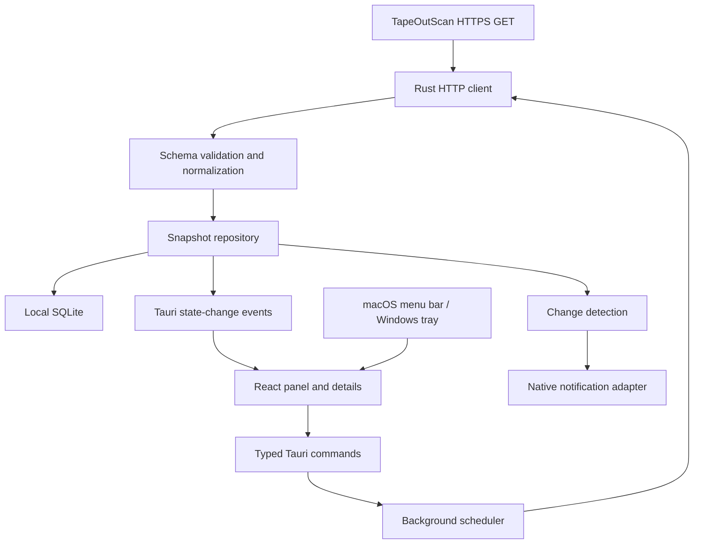

# TapeOut Monitor Desktop Specification

> The UI, window geometry, and account scope are superseded by [the v0.2 iteration specification](specs/2026-10-16-unified-panel-v2.md). Retain the provider contract and data-integrity requirements unless that specification explicitly replaces them.

Status: Proposed for review  
Date: 2026-10-16  
Platforms: Windows 11 x64; macOS 13+ Apple Silicon and Intel  
Data provider: TapeOutScan only

## 1. Product goal and scope

Build a small desktop application that stays in the macOS menu bar or Windows notification area. Clicking its icon opens a compact monitoring panel inspired by the supplied screenshot: dark surfaces, two-column metric cards, prominent numbers, subtle charts, and clearly visible update status.

The application answers three questions: what is happening to my wallet's mining circuits, what is my estimated production, and how is the overall TapeOut network changing?

All remote monitoring data MUST come from `https://tapeoutscan.io`. There is no secondary provider, direct RPC connection, external price API, wallet connection, signature request, or transaction submission. TapeOutScan may aggregate third-party information internally; the desktop app only consumes its responses. The previous secondary-provider proposal is superseded in full.

MVP supports one configured BSC wallet address, a local display name, manual refresh, background refresh, local history, and optional system notifications. Multiple wallets, trading, circuit deployment, cloud accounts, automatic updates, and mobile clients are outside MVP. Opening TapeOutScan in the system browser is supported.

“Mining status” means an indexed on-chain circuit state. The data does not establish physical machine uptime, temperature, fan speed, or network connectivity; these must not appear as hardware monitoring metrics.

## 2. Technology decision

| Approach | Benefits | Costs | Decision |
|---|---|---|---|
| Tauri 2 + React + TypeScript + Rust | Shared UI and data engine; native tray integration; system WebViews | Platform-specific positioning and rendering checks; Rust toolchain | Recommended |
| Electron + React | Familiar desktop ecosystem; bundled browser consistency | Bundled runtime and baseline resource use | Alternative if WebView differences become costly |
| SwiftUI on macOS + WinUI on Windows | Strong native presentation | Two UI implementations and platform-specific maintenance | Not selected for this small cross-platform product |

Use React, TypeScript, Vite, CSS tokens, and lightweight SVG sparklines for presentation. Rust owns networking, scheduling, validation, persistence, and notification decisions. Use reqwest, serde/serde_json with arbitrary-precision number handling, rusqlite, and decimal arithmetic where values require it. Use Tauri tray support and scoped opener, notification, autostart, and single-instance integrations. Pin dependency versions and commit lockfiles during implementation.

Tauri supports tray APIs in Rust and JavaScript; this design keeps lifecycle ownership in Rust. Windows uses WebView2 and macOS uses WKWebView, so identical effects are not assumed. See [tray documentation](https://v2.tauri.app/learn/system-tray/), [WebView documentation](https://v2.tauri.app/reference/webview-versions/), and [distribution documentation](https://v2.tauri.app/distribute/).

## 3. UI specification

### 3.1 Panel layout

Use a 400 CSS-pixel wide panel, a maximum height of 760 CSS pixels, and a viewport-height clamp with a 16-pixel screen margin. Keep header and footer fixed while the central content scrolls. On narrow work areas reduce width to the available area; use one-column cards below 340 pixels. Do not copy the screenshot's red annotation border.

```text
+--------------------------------------+
| TapeOut Monitor            [Settings]|
| My wallet  0x1234...abcd    [Copy]    |
| Synced 20 seconds ago   [Refresh]    |
| [My overview] [Network] [Activity]   |
+--------------------------------------+
| Total mining power | Estimated/day  |
| 85.3K H            | 385.75 BEM      |
| [sparkline]        | Estimate       |
|--------------------+----------------|
| Mining circuits    | Optimal        |
| 37                 | 20             |
|--------------------+----------------|
| BEM balance        | BNB balance    |
| 0.0072 BEM         | 13.2074 BNB     |
|------------------------------------|
| Verified / unverified power         |
| [proportional bar]                  |
|------------------------------------|
| Network: BEM price / verified weight|
|------------------------------------|
| Circuits                  [See all]|
| Task / state / power / optimal      |
+--------------------------------------+
| [Open TapeOutScan]    [Pin] [Quit]   |
+--------------------------------------+
```

All numbers above are illustrative layout content, not live values or defaults. Empty first-launch cards show setup guidance rather than sample balances.

### 3.2 Visual language

Dark background `#181B20`, card background `#242830`, primary text `#F2F4F7`, secondary text `#A9B1BD`, teal `#4BC4A6` for active/verified states, amber `#E6B469` for delayed/estimated states, and red `#EE7474` for failures or losses. Text contrast must meet WCAG AA. Labels and icons accompany color. Cards use 12-pixel radii, 12-pixel internal padding, and 10-pixel gaps. Major values use tabular numerals at 28–32 pixels, labels 12–13 pixels, and secondary values at least 12 pixels.

Start with a solid background on both platforms. Transparency is an optional enhancement after platform verification and must respect reduced-transparency preferences. No continuous animations; loading indicators stop when the panel is hidden. Respect reduced motion and support keyboard focus, Escape, screen-reader labels, and 200% text scaling.

### 3.3 Views and interactions

- My overview: six primary cards, verified/unverified power, a small network strip, and five circuits sorted by current power descending. “See all” opens the same app's resizable detail window, not an expanded tray panel.
- Network: BEM/BNB prices, verified/unverified network weight, daily emission, and low-frequency network statistics with their own update time. Material prices are secondary rows. The local BEM price trend begins only after actual samples exist.
- Activity: the latest 20 address events ordered by block, transaction index when present, and log index. Show task, event label, time, and power change when supplied. Keep missing classifications readable as “Unknown event”.
- Details: circuit search, processor/state/optimal filters, task name, circuit ID, current power, pool, estimated daily BEM, material counts, and estimated value. Use grouped rows explicitly when the API aggregates circuits; show both group count and underlying circuit count.
- Settings: wallet address, local alias, refresh presets of 60/120/300 seconds, notification toggle, launch-at-login toggle, pin preference, and clear-local-history action. The address must be exactly a 20-byte hexadecimal address; compare addresses case-insensitively. No ENS resolution in MVP.
- First launch: show network information without a configured wallet; offer address entry. An empty wallet is valid and displays zero only when explicitly returned by the provider.
- Switching address immediately clears the old wallet from the visible state, loads only that wallet's cache, cancels obsolete requests, and ignores late responses belonging to the previous address.

### 3.4 Platform behavior

| Behavior | macOS | Windows |
|---|---|---|
| Entry point | Template menu-bar icon | Notification-area icon |
| Primary click | Toggle panel near icon | Toggle panel near icon |
| Context menu | Secondary click | Right click |
| Panel placement | Below menu bar, work-area clamped | Adjacent to tray, respect taskbar edge and monitor DPI |
| Dismissal | Focus loss or Escape unless pinned | Same |
| Close details | Hide window; monitoring continues | Same |
| Quit | Explicit menu/footer command | Same |
| Login launch | User-enabled, default off | User-enabled, default off |

Use screen coordinates and scale-factor conversion; test multiple monitors, taskbar positions, menu-bar auto-hide, 100/150/200% Windows scaling, and macOS Retina. If tray coordinates cannot be resolved, center the panel in the active monitor's work area. Do not promise native NSPopover behavior from a generic WebView window. The icon indicates sync health; it must not imply miner health.

## 4. Data contract and display mapping

Interfaces below were inspected on 2026-10-16 using unauthenticated GET requests. These are website interfaces, not a confirmed versioned public API contract. Store fixture shapes and validate them at the adapter boundary.

| Resource | Endpoint | Purpose |
|---|---|---|
| Address | `/api/address/{wallet}` | Summary, assets, circuits, address activity and power history |
| Market | `/api/home?view=market` | Prices, pool weights, emission, material quotes |
| Network | `/api/home` | Network power, pool/processor counts, mining addresses and histories |
| Health | `/api/status` | Provider health on failure or explicit diagnostics |

`/api/home?view=summary` was also checked: it contains market/activity/service information, but does not supply the network power/count objects required here. Do not assume it substitutes for the full network response. Full `/api/home` was approximately 9.3 MB in the observed sample; it is not part of the 60-second polling cycle. A smaller network projection may replace it only after response fields are verified.

### 4.1 Wallet metrics

| UI metric | Address response field | Semantics |
|---|---|---|
| Circuit count | `data.summary.miner_count` | Provider's count; do not use array length |
| Group count | `data.summary.group_count` | Distinct from underlying circuits |
| Total power | `data.summary.total_hashrate` | Display H, preserve provider terminology |
| Estimated daily production | `data.summary.total_estimated_daily_bem` | BEM/day; estimate badge |
| BEM / BNB balances | `data.assets.bem`, `data.assets.bnb` | Null assets means unavailable, not zero |
| Materials | `data.assets.{tapeout,behemoth}_{nand,latch}` | Four separate balances |
| Estimated material cost | `data.summary.total_manufacturing_bnb` | Current-price model, not actual historical expenditure |
| Market estimate | `data.summary.total_firsto_market_value_bnb` | Quote model supplied by TapeOutScan; not realizable proceeds |
| Model payback | `data.summary.manufacturing_payback_days` | Estimate based on provider model, not personal investment return |
| Circuit details | `data.circuits[]` | Includes state, processor, ID, task, power, pool, champion flag, count/IDs |
| Power history | `data.hashrateHistory.points[]` | Use returned timestamps and totals; preserve gaps |
| Recent events | `data.activity.rows[]` | Deduplicate using operation ID and event identity |

Verified/unverified power and optimal circuit count may be derived only from a complete circuit collection with understood grouping semantics. An `is_champion` flag counts represented IDs/count, not one per group. If completeness or group weighting cannot be established, show the breakdown as unavailable while keeping the provider summary. Never infer “offline” from zero power.

### 4.2 Network metrics

| UI metric | Response field | Availability |
|---|---|---|
| BEM / BNB price | Market: `data.market.bem_usd`, `bnb_usd` | Verified |
| Verified / unverified weight | Market: `verified_weight`, `unverified_weight` | Verified; label as weight |
| Daily emission | Market: `daily_emission` | Verified; no hardcoded emission schedule |
| Material prices | Market: four `*_nand_bnb` / `*_latch_bnb` fields | Verified; use quote-specific stale flags |
| Total network power | Network: `data.hashrate.total` | Verified; H |
| Indexed mining circuit count | Sum `data.hashrate.snapshot[].miners` | Verified pool/processor partition; label as indexed snapshot count |
| Pool/processor breakdown | `data.hashrate.snapshot[]` | Rows carry processor, pool, miners, hashrate |
| Mining addresses | `data.miningAddresses.current` | Object exists; exact scalar mapping must be validated before display |

Do not show BEM total supply in MVP: no validated supply field has been established in these responses. Do not sum leaderboard entries to invent whole-network totals. Do not equate weights and power unless provider semantics establish their equivalence. A personal network-share metric is deferred until a compatible denominator and snapshot timing are validated.

## 5. Data and runtime architecture



No hosted backend is required. The Rust process continues monitoring when the panel WebView is hidden. UI components never issue HTTP requests or parse provider DTOs. Repository snapshots are separated by resource and wallet; address, market, and network requests can succeed independently.

Rust modules: `provider/client.rs` handles HTTPS/status/timeout; `provider/dto.rs` describes external shapes; `provider/normalize.rs` maps to domain values; `domain/model.rs` defines snapshots; `runtime/scheduler.rs` owns polling; `storage/repository.rs` owns transactions; `alerts/rules.rs` compares fresh snapshots; `platform/tray.rs` and `platform/window.rs` own OS integration; `commands.rs` exposes a small typed IPC surface.

IPC commands: `get_dashboard`, `set_wallet`, `refresh_resource`, `get_history`, `get_circuits`, `update_settings`, and `clear_history`. Emit `snapshot_updated` with resource, wallet, and revision; UI fetches the corresponding normalized view. Do not send a full historical provider response on every event.

### 5.1 Numeric and freshness rules

- Preserve raw token units and large integer IDs as decimal strings across JSON/IPC. Do not decode `bnb_wei` into a JavaScript Number. Decimal math handles conversions; f64 is permitted only for finite chart coordinates after validation.
- Missing, zero, stale, and unsupported are distinct states. Unknown enum variants map to an explicit unknown state and retain their raw label for diagnostics.
- Each resource carries `fetchedAt`, provider `generatedAt`, `observedBlock`, `confirmedBlock`, `dataAgeSeconds`, and `stale` when available. Assets and market quotes retain their own observation times.
- HTTP success does not reset source age. Mark stale when the provider marks stale, the component observation age exceeds three scheduled intervals, or no successful request has occurred for that duration. Unknown observation time is labeled unknown, not fresh.
- Reject malformed required structures, negative balances/counts, non-finite values, and wallet-owner mismatches. Optional field failure hides only that metric. Ignore unknown extra fields.
- Older observed blocks must not silently overwrite a newer snapshot; keep the last good snapshot and flag inconsistent data for revalidation. No automatic change alert from that response.

### 5.2 Refresh and failure behavior

Address and market default to 60 seconds while the app is running, including when the panel is hidden; user presets affect both. Network full response loads on first opening Network, then at most once every 15 minutes while that view is visible. Closing the view stops full-network polling. The compact overview uses market weights and the last available network snapshot with its timestamp.

Only one request per resource/wallet may run at once; global concurrency is two. Timeout is 20 seconds for address/market and 30 seconds for full network. Manual refresh joins an existing request and has a 10-second cooldown. Failure retries use 60/120/240/480/900-second backoff with jitter; HTTP 429 respects Retry-After as a minimum. 401/403/contract errors require user-visible status and do not trigger endpoint probing. Sleep pauses scheduling; wake triggers one coalesced address/market refresh, without replaying missed ticks.

Keep the last good data on failure and display its timestamp. Never replace failed data with zeros. Cap received bodies at 8 MiB for address and 32 MiB for network; size failures retain cached data and become explicit compatibility errors. Monitor actual transfer costs during the initial integration milestone and increase the default interval if the provider payload makes 60-second polling unsuitable. Provider rate policy remains unconfirmed; no claim of unlimited access is made.

### 5.3 Local storage

Use SQLite under the Tauri application data directory on each platform. Tables: `settings` (versioned JSON), `snapshots` (resource/wallet key, schema version, normalized payload and timestamps), `metric_samples` (wallet/resource, metric, time, decimal value, source time), and `event_baselines` (wallet, event identity, baseline time).

Persist normalized snapshots, not the entire network history response. Record one metric sample per five-minute bucket only when the source observation advances; retain 30 days and at most 10,000 event identities per wallet for 30 days. Preserve gaps during sleep/offline periods. Use transactions, schema migrations, and startup integrity checks. A corrupt cache may be quarantined and rebuilt after preserving settings; no remote data is modified. Clearing history does not remove the configured wallet.

### 5.4 Notifications

Off by default; request OS permission only after user enables them. MVP alerts: confirmed optimal-position loss/gain and a configured personal power drop (default threshold 10%). Establish the first fresh snapshot as a silent baseline. Require fresh, complete snapshots and two consecutive observations for inferred changes; known events must be below the provider's confirmed block before notifying. Deduplicate by event identity or wallet/circuit/change revision. Coalesce notifications over five minutes.

Changing wallet or recovering from a stale/sleep gap establishes a new silent baseline. A disappeared circuit may have transferred ownership; do not report it as stopped or offline. Notifications report “change observed” rather than proving an underlying cause when no event supplies it. The app cannot notify while quit or the computer is asleep.

## 6. Security and operational boundaries

Hardcode the TapeOutScan HTTPS origin in the provider client. Reject redirects to other origins and never follow source URLs embedded in market responses. No remote HTML is loaded into application windows. Apply restrictive CSP and minimal Tauri capabilities. Validate all IPC inputs. Open only constructed TapeOutScan HTTPS links in the system browser; escape all provider labels in UI. Logs omit full wallet addresses by default and never collect credentials. No telemetry in MVP.

Authentication challenges remain visible compatibility failures; do not implement login scraping. Only GET endpoints described here are in scope.

## 7. Repository and delivery layout

Create an independent `desktop/` application within this repository; do not couple it to existing treasury UI or smart contracts.

```text
desktop/
  package.json
  src/
    app/
    features/setup/
    features/overview/
    features/network/
    features/circuits/
    features/activity/
    features/settings/
    components/
    bridge/
    styles/
  src-tauri/
    src/provider/
    src/domain/
    src/runtime/
    src/storage/
    src/alerts/
    src/platform/
    src/commands.rs
    capabilities/
    migrations/
    tests/fixtures/
  tests/
  README.md
```

Target Windows 11 x64 and macOS 13+ on Apple Silicon/Intel. Validate the chosen dependency set against this declared minimum before freezing it. Build and test packages on native OS runners. Deliver macOS app/DMG and Windows NSIS installer with WebView2 bootstrap handling. macOS signing/notarization and Windows signing depend on owner-provided credentials; unsigned development builds remain usable for testing and are not described as production-ready. Do not publish releases or enable login launch as part of document creation.

## 8. Implementation plan and acceptance gates

### Milestone 1: Provider contract and fixtures

- [ ] Create `desktop/src-tauri/tests/fixtures/` from redacted address, empty-wallet, market, and network response samples; record capture time and endpoint.
- [ ] Implement client/DTO/normalization modules and resource metadata.
- [ ] Verify grouping/count semantics and network address scalar; unsupported optional metrics remain hidden.
- [ ] Add Rust contract tests for missing assets, grouped circuits, unknown states, large integers, older blocks, stale quotes, and schema changes.
- [ ] Gate: one actual wallet and market response normalize without fabricated values; capture response sizes and polling bandwidth estimate.

### Milestone 2: Local runtime

- [ ] Implement repository migrations and resource-isolated persistence.
- [ ] Implement single-flight scheduler, timeout, backoff, Retry-After, sleep/wake recovery, and wallet request generations.
- [ ] Add fake-clock/fake-HTTP tests for 429, timeout, wallet-switch races, partial success, restart cache, and retention.
- [ ] Gate: hiding all windows leaves monitoring active; old-wallet responses cannot update the selected wallet.

### Milestone 3: Reviewable UI

- [ ] Implement setup and the specified two-column overview with real normalized DTOs.
- [ ] Implement Network, Activity, details, settings, and SVG trends.
- [ ] Add component tests for unavailable versus zero, stale versus fresh, grouped counts, keyboard access, and address switching.
- [ ] Gate: screenshots at 400 pixels and 200% text scale remain readable; first launch, empty wallet, offline cache, and partial failures are explicit.

### Milestone 4: Native shell and optional alerts

- [ ] Implement tray/menu-bar click, context menu, work-area positioning, pinning, Escape, and explicit quit.
- [ ] Add single-instance behavior and opt-in launch-at-login.
- [ ] Implement notification baselines, confirmation gating, and deduplication tests.
- [ ] Gate: test multiple monitors/DPI on both OS families; stale data, initial load, resume, and ownership transfer do not cause false “offline” alerts.

### Milestone 5: Packaging and release candidate

- [ ] Provide frontend checks through `npm run lint`, `npm run typecheck`, `npm run test`, and `npm run build` in `desktop/`.
- [ ] Provide Rust checks through `cargo fmt --check`, `cargo clippy --all-targets -- -D warnings`, and `cargo test` in `desktop/src-tauri/`.
- [ ] Build native installers using `npm run tauri build`; verify clean install, restart, uninstall, WebView prerequisites, and per-user data location.
- [ ] Record 30-minute hidden-window CPU/memory/network use. Initial targets: median idle CPU below 1%, total resident memory below 150 MiB, excluding shared WebView accounting; report measurements rather than asserting guarantees.
- [ ] Document any unavailable signing credentials and platform tests not actually performed.
- [ ] Gate: both platform installers tested, required checks pass, sole monitoring origin verified, and all displayed fields trace to a validated TapeOutScan field or an explicitly documented derivation.

Milestones are sequential review gates, not calendar promises. No git commits or publication are authorized by this plan; commit only when requested. Implementation begins after review of this specification.

## 9. Source references and unresolved external constraints

- [TapeOutScan](https://tapeoutscan.io/)
- [Provider status](https://tapeoutscan.io/api/status)
- [Market response](https://tapeoutscan.io/api/home?view=market)
- [Network response](https://tapeoutscan.io/api/home)
- [Address response used for shape verification](https://tapeoutscan.io/api/address/0x8baf8c4f3ae2fa5294a3cb124bb88e1a5dfe4d67)

The sample wallet is a public response fixture source, not the user's wallet and not a default watch address. Endpoint stability and permitted polling frequency are not documented in the evidence collected. MVP handles incompatibility visibly and does not add a fallback provider. These constraints affect integration validation, but do not prevent reviewing the UI or architecture now.
